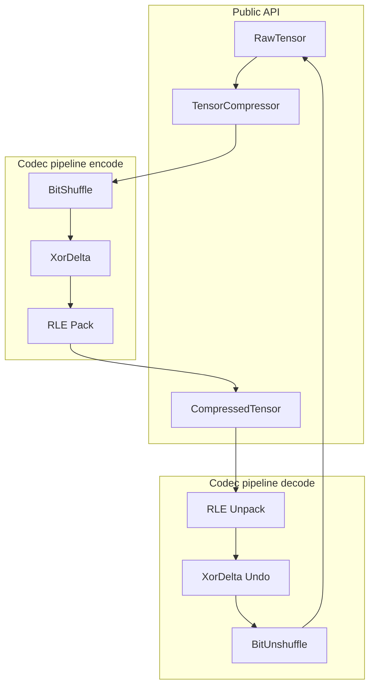
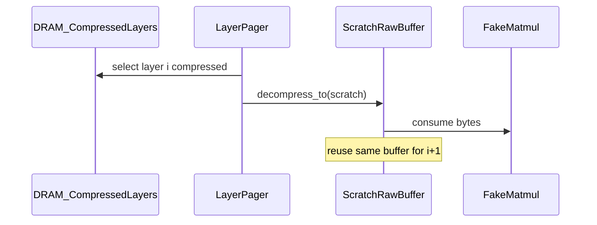

# TC-Runtime — Technical Architecture

Companion to [`plan.md`](plan.md) and [`cursorrules.md`](cursorrules.md).  
This document is the source of truth for **format, algorithms, modules, and data flow**.

---

## 1. System overview

TC-Runtime is a **lossless tensor block codec** plus a thin optional **layer paging** demo. It is not a full inference engine.



**Design intent:** Weights reside in DRAM as `CompressedTensor` payloads. Before a layer runs, decompress into a reusable scratch `RawTensor` (or raw buffer) using SIMD-friendly kernels, then consume with existing compute code (outside this repo for now).

---

## 2. Problem model (technical)

### 2.1 Quantities

- Let weight tensor \(W\) have byte size \(N = \mathrm{numel}(W) \cdot \mathrm{sizeof(dtype)}\).
- Uncompressed traffic to load \(W\) once ≈ \(N\) bytes from DRAM.
- Compressed size \(C = |payload| + |header|\).
- **Compression ratio** \(R = N / C\) (report as e.g. `1.78x`; store as `compression_ratio_x100 = round(R * 100)`).
- **Decode throughput** \(T_{dec} = N / t_{decode}\) (bytes of uncompressed output per second).

### 2.2 When this helps

Compression helps a bandwidth-bound load if:

\[
\frac{C}{B_{dram}} + t_{decode} < \frac{N}{B_{dram}}
\]

(rough model; ignores cache effects). So decode must be fast relative to the bytes saved. This is why **decode GB/s** matters as much as ratio.

### 2.3 Relationship to quantization

| Approach | Bytes | Values |
|----------|-------|--------|
| Quantization | Fewer | Changed (lossy) |
| TC-Runtime | Fewer on the bus / in resident set | Unchanged (lossless) |
| Both (future) | Pack already-quantized INT8/INT4 further | Still lossless w.r.t. quantized values |

Portfolio framing: **complementary**, not competitive, with quantization.

---

## 3. Public data structures

Evolve existing headers in `include/tensor.h` and `include/compressor.h`.

### 3.1 `DataType`

```cpp
enum class DataType : uint8_t {
    FP32 = 0,
    FP16 = 1,
    INT8 = 2,
};
```

Element sizes: FP32=4, FP16=2, INT8=1.

### 3.2 `RawTensor`

- `alignas(64)` structure (cache-line friendly metadata; payload may be heap-allocated via `std::vector`)
- `std::vector<uint8_t> data` — raw bytes, row-major, tightly packed
- `std::vector<size_t> shape` — dimensions
- `DataType dtype`
- `size_bytes()` → `data.size()`
- Invariant: `data.size() == product(shape) * element_size(dtype)` (enforce in helpers)

### 3.3 `CompressedTensor`

- `alignas(64)`
- `compressed_data` — full frame: **header + payload** (see format)
- `shape`, `dtype` — denormalized for convenience (must match header)
- `original_size_bytes`
- `block_count` — number of codec blocks
- `compression_ratio_x100`
- **Must end with semicolon** (current stub is missing `;`)

### 3.4 `TensorCompressor`

```cpp
CompressedTensor compress(const RawTensor& tensor);
RawTensor decompress(const CompressedTensor& compressed);

// Preferred internal / advanced API (add):
void compress_to(const RawTensor& in, CompressedTensor& out);
void decompress_to(const CompressedTensor& in, RawTensor& out); // pre-reserve out.data
```

Hot path: prefer `decompress_to` with pre-sized `out.data` to avoid allocation churn.

Rename/clarify private methods:

- `bit_shuffle_*` / `bit_unshuffle_*` — keep scalar + simd variants
- Existing names `bit_shuffle_sse` may remain as thin wrappers or be renamed to `bit_shuffle_simd` with comments; do not leave misleading SSE-only naming if implementing AVX2

---

## 4. On-wire / in-memory frame format (`TCF1`)

Define in `include/format.h`. Little-endian. Versioned.

### 4.1 Header (fixed, 64 bytes)

| Offset | Size | Field | Notes |
|--------|------|-------|-------|
| 0 | 4 | magic | `'T' 'C' 'F' '1'` |
| 4 | 2 | version | `1` |
| 6 | 2 | flags | bit0: payload uses shuffle; bit1: xor; bit2: rle; etc. |
| 8 | 1 | dtype | `DataType` |
| 9 | 1 | ndims | 1–8 |
| 10 | 2 | reserved0 | 0 |
| 12 | 4 | block_size | codec block size in bytes (e.g. 65536) |
| 16 | 4 | block_count | |
| 20 | 4 | reserved1 | 0 |
| 24 | 8 | uncompressed_size | |
| 32 | 8 | payload_size | bytes following header |
| 40 | 24 | shape[6] padded | first `ndims` entries used; rest 0; 64-bit each would exceed — **use 4×uint32 for first 4 dims + ndims check**, or store shape after header |

**Simplification for v1 (recommended):**

- Fixed 64-byte prefix as above with `shape_packed[4]` as `uint32_t[4]` and `ndims ≤ 4` for v1  
- If more dims needed later, bump version  

CRC optional in v1 (skip for speed; can add flags bit later).

### 4.2 Payload

Sequence of **blocks**:

```
for each block:
    u32 raw_block_len
    u32 comp_block_len
    u8  comp_bytes[comp_block_len]
```

Last block may be shorter than `block_size`.  
Each block independently: shuffle → xor → rle on that block’s bytes (enables parallel decode later).

### 4.3 Flags and ablations

Flags select which stages are active so ablations share one format:

- `FLAG_SHUFFLE = 1 << 0`
- `FLAG_XOR     = 1 << 1`
- `FLAG_RLE     = 1 << 2`

Full pipeline: all three set. Bench can emit shuffle-only etc.

---

## 5. Algorithm specifications

### 5.1 Bit-shuffle (FP32)

Treat the block as `n` consecutive FP32 elements (`n = block_bytes / 4`).  
Each element is 4 bytes `b0,b1,b2,b3` (IEEE754 little-endian memory order).

**Byte-shuffle (v1 default — implement first):**  
Transpose from AoS bytes to SoA byte planes:

```
input:  [e0b0 e0b1 e0b2 e0b3 | e1b0 e1b1 ...]
output: [e0b0 e1b0 e2b0 ... | e0b1 e1b1 ... | e0b2 ... | e0b3 ...]
```

This clusters sign/exponent-ish bits without bit-level ops and matches common “shuffle filter” practice.

**Bit-plane shuffle (optional v1.1):**  
Transpose to 32 bit-planes. Higher complexity; only add if byte-shuffle ratios disappoint and schedule allows.

Document which variant is active in header flags or a `shuffle_mode` nibble.

**INT8 / FP16:**  
- INT8: shuffle is no-op or identity at element size 1; still may XOR+RLE  
- FP16: 2-byte plane shuffle analogous to FP32

### 5.2 XOR-delta

On the shuffled byte stream `s[0..L)`:

```
out[0] = s[0]
out[i] = s[i] XOR s[i-1]   for i > 0
```

Decode:

```
s[0] = out[0]
s[i] = out[i] XOR s[i-1]
```

Widening: process with `uint64_t` or SIMD chunks carefully (dependency chain on decode — document; may use blocked XOR with restart markers later if needed). **v1:** simple sequential XOR-delta; SIMD can still help encode and other stages.

### 5.3 RLE variant (v1: “Zero-RLE + literal”)

Goal: exploit zero-dense streams after XOR on correlated data.

Simple format (document precisely in code comments too):

```
stream of tokens:
  - 0x00 + u8 count     => emit (count+1) zero bytes   (count 0..255 → 1..256 zeros)
  - 0x01 + u8 n + n bytes => emit n literal bytes       (n 1..255)
  - 0x02 + u16 countLE  => emit (count) zero bytes      (optional extended zero run)
```

Or even simpler **run-length on bytes** (classic):

```
[value:u8][run_len:u8] repeated; run_len >= 1
```

**Decision for v1 (locked):** use classic `[value][run_len]` with `run_len in 1..255`, repeated for longer runs. Easy to implement, easy to test. If ratio is weak on zeros, upgrade to zero-specialized RLE in Phase 2 without changing the public tensor API (bump format version).

Decode must reject truncated streams gracefully (tests for malformed input optional but good).

### 5.4 Encode / decode orchestration

**Encode block:**

1. Take up to `block_size` bytes from raw tensor  
2. If SHUFFLE: bit/byte shuffle into temp  
3. If XOR: xor-delta into temp2  
4. If RLE: rle into output buffer  
5. Write block lengths + bytes  

**Decode block:** reverse order with inverse stages.

**Temps:** use thread-local or member scratch buffers sized to `block_size`; no per-block heap alloc on decode hot path after warm-up.

---

## 6. SIMD architecture

### 6.1 Principles

1. Scalar path is the **correctness oracle** — SIMD must match scalar byte-for-byte  
2. Feature-gate with CMake (`TC_HAVE_AVX2`, `TC_HAVE_NEON`)  
3. Dispatch: function pointers or `if constexpr` / separate TUs  
4. Alignment: prefer 32-byte aligned loads when possible; handle tails with scalar  

### 6.2 What to vectorize first

Priority for portfolio impact:

1. **Byte-shuffle / unshuffle** (high arithmetic regularity)  
2. RLE decode scan (harder; optional)  
3. XOR-delta encode (easy); decode is serial — low priority  

### 6.3 AVX2 notes

- Use `<immintrin.h>`  
- Compile SIMD TU with `-mavx2` (GCC/Clang) or `/arch:AVX2` (MSVC)  
- Do not compile SIMD TU on hosts without support; auto-detect in CMake  

### 6.4 Apple Silicon / ARM

If builder host is `arm64`:

- Phase 1 scalar still required  
- Phase 2: implement NEON shuffle helpers **or** document SIMD deferred and tune scalar  
- Do not pretend AVX2 exists  

---

## 7. Module responsibilities

| Module | Responsibility | Must not do |
|--------|----------------|-------------|
| `format` | Header pack/unpack, magic/version checks | Codec math |
| `bitshuffle` | Shuffle/unshuffle | RLE |
| `xor_delta` | Delta XOR encode/decode | Allocate tensors |
| `rle` | Pack/unpack | Know about dtypes |
| `compressor` | Pipeline glue, block loop, metadata | SIMD intrinsics inline spaghetti — call into `simd/` |
| `simd/*` | Vector kernels | Format policy |
| `runtime/layer_pager` | Demo residency pattern | Model math |
| `benchmarks` | Timing + baselines | Change codec semantics |
| `tests` | Correctness | Performance claims |

---

## 8. CLI surface (`src/main.cpp`)

```
tc compress  -i raw.bin -o out.tcf --dtype fp32 --shape 4096,4096
tc decompress -i out.tcf -o raw.out.bin
tc info      -i out.tcf
tc bench     --synthetic mlp|random|zeros --size ...
```

Phase 0 may implement `info` + synthetic bench only.

---

## 9. Benchmark methodology

### 9.1 Metrics

- Compression ratio \(R = N/C\)  
- Encode throughput, decode throughput  
- Optional: peak RSS during decompress (should stay flat with scratch reuse)  

### 9.2 Datasets

1. **zeros** — sanity upper bound  
2. **random FP32** — lower bound / stress lossless  
3. **correlated synthetic** — shared exponents + smooth noise (primary “weight-like”)  
4. **optional real dumps** — named files under `data/` (gitignored if large) with docs on provenance  

### 9.3 Baselines

- **raw**: memcpy timing as bandwidth reference  
- **zlib**: level 6 default (document)  
- **lz4**: default frame or block API (document)  

Link zlib (system or FetchContent); lz4 via FetchContent if needed.

### 9.4 Timing protocol

- Release builds only for published numbers  
- Warm-up ≥ 3 iters; measure ≥ 20 iters; report median  
- Record: CPU brand, OS, compiler version, ISA flags  

---

## 10. Optional layer pager (Phase 3)



API sketch:

```cpp
class LayerPager {
  void load_library(std::vector<CompressedTensor> layers);
  std::span<const uint8_t> map_layer(size_t i); // decompress into scratch, return view
};
```

No real GEMM required; `FakeMatmul` can `std::accumulate` or volatile touch bytes to prevent DCE.

---

## 11. Error handling

- Wrong magic / version → throw `std::runtime_error` or return `std::expected` (C++20: prefer exception for v1 simplicity in library, or error codes — **locked: exceptions for v1**)  
- Size mismatch / truncated payload → throw  
- Tests cover happy path + a few corruptions  

---

## 12. Security / robustness note

This is a **trusted local codec** for a portfolio project. Do not claim hardened untrusted-input parsing. Basic bounds checks are still required to avoid buffer overruns during decode (good engineering hygiene).

---

## 13. Mapping from old README claims

| README claim | Architectural treatment |
|--------------|-------------------------|
| 1.78× ratio, 4.2 GB/s, −18.4% L3 | Hypotheses only until measured; L3 via `perf` is optional stretch |
| AVX2 vectorized | Phase 2, if host supports |
| No malloc on decompress | Enforce via `decompress_to` + scratch reuse |
| Layer-aware | Block/paging story; not ML-layer semantics magic |

---

## 14. Extension points (post-portfolio)

- Format v2: restartable XOR blocks for parallel decode  
- NEON / AVX-512 kernels  
- INT4 nibbles packing after external quantizer  
- Plugin ABI for real runtimes  
- Activation / KV cache experiments  

Do not build these until Phases 0–2 are done.
